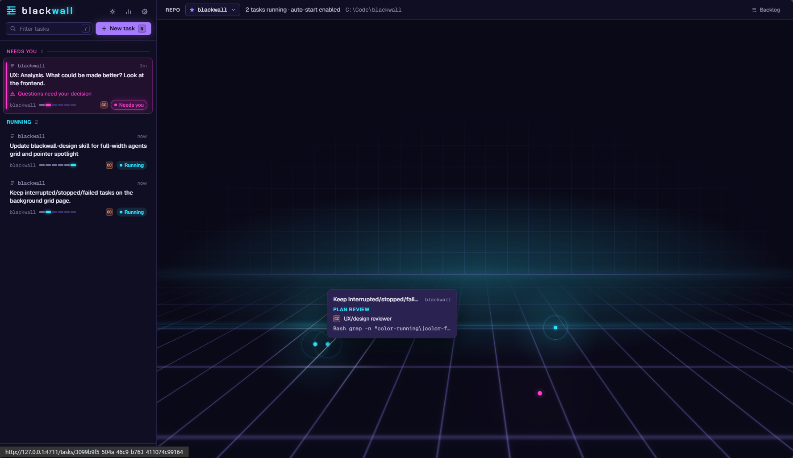

# blackwall

A local, single-user, browser-based control room for coding agents. blackwall runs Claude Code, GitHub Copilot CLI and OpenCode as headless subprocesses against your own git repos. Tasks come from Jira Cloud issues, GitHub/GHE pull requests (Work on PR or Review PR), GitHub/GHE issues or Blackwall tasks you write yourself (free text).

Agents plan, grill, implement and review each other's work, on any of the CLIs. You approve the plan, answer the questions only you can answer, triage the findings and confirm every outbound action.



Tasks can be picked up from Jira, Github Issues (or PRs for review), or the internal task-system in blackwall itself.


## How to run: Quickstart

1. Clone repo
2. `pnpm install`
3. `pnpm start` (or `pnpm desktop` to run as a desktop app (Elecetron app))

## How it works

```
Inform ──► Plan review / grill ──► [human plan approval] ──► Implement ──► Checks ──► Code review panel
                                                              ▲                                 │
                                                              └──── blocking findings (≤3) ◄────┘
                                                                                                 │ approved
                                                                                                 ▼
                                                                              Summarize ──► [human finish confirm]
```

- Review PR mode runs Inform → review panel → triage → inline PR review comments. At triage you can step through the PR's diff hunk by hunk from the Diff tab and comment on any hunk; your comments are posted with the reviewers' findings, inline as you wrote them. You can also delete findings you don't want posted before you post the review. A PR stacked on another PR is reviewed, and its diff shown, against its own base branch, so each PR in a stack is reviewed on its own.
- GitHub issue tasks work on a new `feature/<n>-…` branch and finish by pushing it, opening a PR that closes the issue and commenting on the issue. The PR body and comments carry a brief description of the change; the detailed summary stays in blackwall. You can also opt in to a comment on the issue when work starts and when you approve the plan; you see and edit each one first.
- Each task gets its own git worktree at `../<repo>.worktrees/<task>`.
- The harness commits after each implement or fix round. Agents never push. `main` is pushed only when you click Push on a repo's Backlog and confirm it; the pipeline never pushes it.
- Critical and High findings loop back to the implementer, for at most 3 fix rounds before escalating to you.
- Reviewers are read-only. Implementers can edit and use the shell but cannot reach remotes.
- Claude Code, Copilot CLI and OpenCode implementers can hand narrow jobs to a cheaper `blackwall-worker` sub-agent (Haiku on Claude Code, `claude-haiku-5.5` on Copilot, and on OpenCode Haiku for `anthropic/` and `github-copilot/` models, otherwise the run's own model) that gets only a short brief. Running sub-agents show as small dots beside their task's dot on the home grid, and their work shows nested, collapsed, under the call that started them in Agent output.
- A per-repo backlog with an auto-runner that respects concurrency caps and CLI usage limits. When local `main` has commits `origin/main` doesn't (for example after free-text tasks merge into it), the Backlog header offers a confirmed "Push N commits to main". It never fetches or forces.
- A task can propose follow-up tasks, in its own repo or another registered one. You pick which to create at finish; they land in the backlog as waiting items. An analysis-only task can deliver just these follow-ups.
- Interrupted steps resume the same CLI session, or start afresh with their original prompt if Claude Code no longer has it.

Implementers may save screenshots (PNG, JPEG, GIF or WebP) to `.blackwall/artifacts/` in the worktree. They show in the task's Artifacts tab, updating while the task runs. The `.blackwall/` scratch folder, also used for Jira attachments, is ignored by its own `.gitignore` and never committed.

## Features

- Agent library with role defaults per stage. Agents are not tied to a CLI: each repo picks the CLI its tasks run on, and a task can run single agents on the other one.
- Finding tags and severities, with force-fix and force-ignore on any finding; force-fixing at the finish gate, or while the summary is being written, runs one more fix round right away
- Step through the branch diff hunk by hunk from the Diff tab and comment on any hunk; the comments become force-fixed findings. Sending them at the finish or escalation gate runs a fix round right away; at triage they are fixed in the round that approving triage starts. In Review PR tasks, comments made at triage are added to the findings to post instead
- Connections to GitHub.com, GHE and Jira Cloud, with tokens in the OS keychain
- Repo registry with auto-suggested check commands
- Live agent output and per-round diffs
- Review requests: a pill on the home screen counts the open pull requests waiting on your review across every GitHub/GHE connection (requests to you or one of your teams, not drafts, not yet approved), and opens a list grouped by host at `/reviews`. Each PR has "Work on task", which adds it as a Review PR task to the backlog of the registered repo for its repository and starts it at once when that repo's backlog runs automatically; rows that already have a task or backlog item link to it instead. Private PRs only appear if the token has `repo` scope (classic) or read access to pull requests on those repos (fine-grained).
- Assigned issues: a pill next to it counts the open issues assigned to you across every GitHub/GHE connection, and opens a list grouped by host at `/issues`. Each issue has "Work on task", which adds it with defaults to the backlog of the registered repo for its repository and starts it at once when that repo's backlog runs automatically; rows that already have a task or backlog item link to it instead. Private issues only appear if the token has `repo` scope (classic) or Issues read access on those repos (fine-grained).
- Repo issues: each repo's Backlog lists the repository's open GitHub issues under "GitHub issues", whoever they are assigned to, up to the 100 most recently updated. "Work on issue" assigns the issue to you and starts a task right away, even when the runner is off; assigning needs `repo` scope (classic) or Issues write access (fine-grained). Private repos need the same token scopes as Assigned issues. The GitHub issue lists (here and in Assigned issues) refresh every 60 seconds by default while the window is focused; change it under Settings → Backlog.
- Needs-you inbox, with the count in the tab title (and on the dock or taskbar badge in the desktop app) and optional desktop notifications (Settings → Notifications)
- Optional desktop window with a tray icon (`pnpm desktop`)
- Dark and light themes
- Keyboard shortcuts

## Requirements

- Node.js 22+ and pnpm
- git
- At least one agent CLI, installed and logged in:
  - [Claude Code](https://code.claude.com) (`claude`)
  - [GitHub Copilot CLI](https://docs.github.com/en/copilot) (`copilot`)
  - [OpenCode](https://opencode.ai) (`opencode`)

## Running

```sh
git clone <this repo> ~/code/blackwall
cd ~/code/blackwall
pnpm install
pnpm start          # builds if output is missing or stale, starts on 127.0.0.1 and opens your browser
```

`pnpm start -- --no-open` skips opening the browser. `pnpm start -- --port 4711` picks a port (default 4711, or `BLACKWALL_PORT`). The build is skipped when nothing under the workspace sources or config has changed since the last `pnpm start` build.

The server binds to `127.0.0.1` only and prints a URL containing a per-launch token. Data lives in `~/.blackwall/`; `BLACKWALL_HOME` overrides the data directory. Personal access tokens are stored in your OS keychain, never in the database.

For headless use, set `BLACKWALL_TOKEN_<CONNECTION>` to override a connection's keychain token. The suffix is the connection name in upper case with other characters replaced by `_`, so `acme.ghe.com` reads `BLACKWALL_TOKEN_ACME_GHE_COM`.

## Desktop app

```sh
pnpm desktop        # builds if output is missing or stale, then opens blackwall in its own window
```

The desktop app is an Electron window around the same server that draws its own title bar that follows the theme, run from a source checkout after `pnpm install`. There are no installers yet.

- **Requirements:** everything browser mode needs. Node.js 22+ must be on `PATH`, because the server runs on your system Node, not Electron's. On macOS and Linux the app reads `PATH` from your login shell, so CLIs installed by a version manager are found even when launched from Finder or a desktop launcher.
- **Port:** 4712 (`BLACKWALL_DESKTOP_PORT` overrides it). The port stays fixed so the theme and selected repo are kept between launches. `BLACKWALL_PORT` and `BLACKWALL_WEB_PORT` are ignored in desktop mode.
- **Data:** the same data directory as browser mode (`~/.blackwall/`, or `BLACKWALL_HOME`). Only one instance can use a data directory at a time, so `pnpm desktop` refuses to start while `pnpm start` is running on the same one, and the other way round.
- **Tray and badge:** the tray icon opens the window and holds Quit. The number of tasks that need you shows on the dock or taskbar icon and in the tray tooltip.
- **Quitting:** closing the window, Quit in the tray or the app menu all ask before quitting, and say how many agents are running. Confirming stops those agents the same way Ctrl+C does for `pnpm start`, so their steps resume on the next launch.

## Quick-launch function

Add a one-word launcher to your shell profile so `blackwall` starts the tool from anywhere.

### Windows (PowerShell)

Open your profile with `notepad $PROFILE` and add:

```powershell
function blackwall {
    pnpm --dir "C:\Code\blackwall" start -- @args
}
```

### macOS / Linux (bash or zsh)

Add to `~/.bashrc` or `~/.zshrc`:

```sh
blackwall() {
  pnpm --dir "$HOME/code/blackwall" start -- "$@"
}
```

Replace the path with where you cloned the repo. Restart the shell (or `. $PROFILE` / `source ~/.zshrc`), then run `blackwall` from any directory. Flags pass through: `blackwall --no-open --port 5000`.

## Development

`pnpm dev` runs the server under `tsx watch` plus the Vite dev server with hot reload. On Windows, `./start.ps1` does the same and opens the browser once Vite is up.

```sh
pnpm test           # Vitest, against sources (no build needed)
pnpm typecheck
pnpm lint
pnpm format:check
```